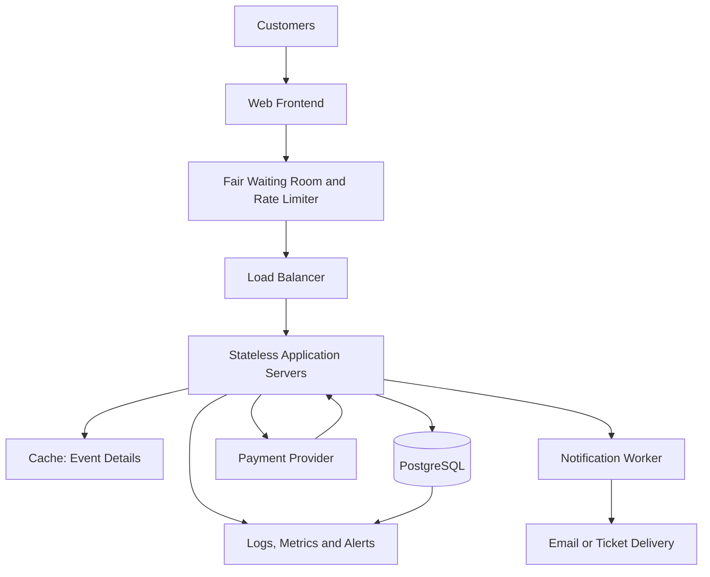

# TicketHub — System Design

## 1. Requirements

### Context

TicketHub is a website where users browse concerts and events, select seats, purchase tickets, and view their orders. The platform has 2 million registered users and must remain reliable during popular ticket releases.

### Functional requirements

- Users can register, sign in, and view their account.
- Users can browse, search, and view event details.
- Users can view the seats available for a particular event.
- Users can temporarily hold available seats while completing checkout.
- Users can pay for an order and receive a confirmation.
- Users can view their purchased tickets and order history.
- The system releases expired holds and makes those seats available again.
- Administrators can create events and configure their seats and ticket prices.

### Non-functional requirements

- **Performance:** Event pages should load quickly under normal traffic. During a major sale, the system should remain responsive and provide clear waiting or retry messages when overloaded.
- **Correctness:** A seat must never be sold to two customers for the same event. Payment and order status must remain consistent.
- **Fairness:** Users should be admitted to a major sale through a fair queue, with rate limits to reduce automated abuse. Users should receive clear hold-expiry times and checkout feedback.
- **Availability:** The service should tolerate individual application-server failures and recover from temporary payment-provider failures.
- **Security:** Authentication, authorization, encrypted connections, input validation, and safe handling of payment-provider tokens are required.
- **Scalability:** The system must handle sudden increases in browsing and purchasing traffic.
- **Observability:** Logs, metrics, and alerts should identify slow requests, failed payments, queue delays, and booking conflicts.

## 2. Traffic and Capacity Estimates

### Given facts

- Registered users: 2,000,000
- Normal daily visitors: 50,000
- Pages viewed per visitor: 10
- Normal daily ticket sales: 5,000
- Major sale: 200,000 people attempt to buy 20,000 seats in 10 minutes

### Normal traffic

Daily page views:

50,000 visitors × 10 pages = **500,000 page views/day**

Average page-view rate across 24 hours:

500,000 ÷ 86,400 seconds ≈ **5.8 page views/second**

Normal ticket sales average:

5,000 ÷ 86,400 seconds ≈ **0.058 tickets/second**, or about 208 tickets/hour averaged across the day.

Actual traffic will vary by hour, so the average is not sufficient for capacity planning. The system should be load-tested against higher-than-average traffic.

### Major-sale traffic

Average people attempting to buy tickets:

200,000 ÷ 600 seconds ≈ **333 people/second**

The 20,000 available seats can satisfy only 10% of the 200,000 people attempting to buy them.

For capacity planning, assume each person generates five API requests during browsing and checkout. This produces approximately:

333 × 5 ≈ **1,665 requests/second on average** during the sale.

If traffic peaks at three times that average, the system should be tested at approximately **5,000 requests/second**. This is an initial planning assumption, not a measured requirement; load testing should refine it.

The major sale therefore creates a sharp burst of demand, far beyond ordinary ticket-purchasing traffic. The system needs a waiting room, caching for read-heavy event information, horizontally scalable application servers, and strict database controls for seat reservations.

## 3. API Design

All endpoints use HTTPS and JSON. Endpoints that access private user information require authentication.

| Method and endpoint | Purpose | Expected response |
|---|---|---|
| `GET /events` | Browse and search events | `200 OK` |
| `GET /events/{eventId}` | View event details | `200 OK` |
| `GET /events/{eventId}/seats` | View seat availability | `200 OK` |
| `POST /events/{eventId}/holds` | Temporarily reserve available seats | `201 Created` |
| `GET /holds/{holdId}` | Check a hold's status and expiry | `200 OK` |
| `POST /orders` | Create an order from a valid hold | `201 Created` |
| `POST /orders/{orderId}/payment` | Initiate payment for an order | `202 Accepted` |
| `GET /me/tickets` | View the signed-in user's tickets | `200 OK` |
| `GET /orders/{orderId}` | View order status | `200 OK` |

### Example: hold seats

Request:

```json
{
  "seatIds": ["A12", "A13"]
}
```

A successful response includes the hold identifier and expiry time:

```json
{
  "holdId": "hold-123",
  "status": "ACTIVE",
  "expiresAt": "2026-11-01T12:05:00Z"
}
```

If a requested seat is already held or sold, the API returns `409 Conflict` and does not create a partial hold unless partial reservations are explicitly supported.

Other important status codes include `400 Bad Request` for invalid input, `401 Unauthorized` for an unauthenticated request, `404 Not Found` for missing resources, and `429 Too Many Requests` when rate limits are exceeded.

Payment requests should support an idempotency key so retries cannot accidentally charge a customer twice. The system should confirm an order only after receiving a verified payment-provider result.

## 4. Data Model

A relational database such as PostgreSQL is suitable because seat allocation and order creation require transactions, constraints, and reliable relationships.

### Tables

**users**
- `id` — primary key
- `email` — unique, required
- `password_hash` — required
- `created_at` — timestamp

**events**
- `id` — primary key
- `title` — required
- `venue_name` — required
- `starts_at` — timestamp
- `sale_starts_at` — timestamp
- `status` — for example, scheduled, on-sale, or completed

**event_seats**
- `id` — primary key
- `event_id` — foreign key to `events.id`
- `seat_label` — for example, A12
- `price` — monetary value stored using a suitable exact decimal or integer minor-unit representation
- `status` — available, held, or sold
- `hold_expires_at` — nullable timestamp
- `hold_token` — nullable identifier for the active hold

Constraint: `UNIQUE(event_id, seat_label)` ensures the same seat label cannot be duplicated for one event. A venue seat can be reused for a different event.

**orders**
- `id` — primary key
- `user_id` — foreign key to `users.id`
- `status` — pending, paid, failed, or expired
- `total_amount` — total order amount
- `idempotency_key` — unique per relevant user or payment operation
- `created_at` — timestamp

**order_items**
- `id` — primary key
- `order_id` — foreign key to `orders.id`
- `event_seat_id` — foreign key to `event_seats.id`
- `price_at_purchase` — recorded purchase price

Constraint: `UNIQUE(event_seat_id)` in the sold-ticket records prevents a seat from appearing in more than one completed sale. This uniqueness rule must be enforced by the database, not only by application code.

**payments**
- `id` — primary key
- `order_id` — foreign key to `orders.id`
- `provider_reference` — unique payment-provider reference
- `status` — pending, succeeded, or failed
- `amount` — amount requested or paid
- `created_at` — timestamp

### Relationships

- One user can create many orders.
- One event has many event seats.
- One order has one or more order items.
- Each order item refers to one event seat.
- An order can have payment attempts, while each payment record belongs to one order.

## 5. Preventing Double-Booking

The application must never depend on a preliminary availability check alone. Two customers can see a seat as available at nearly the same time.

### Seat-hold process

1. A customer requests a hold for one or more seats.
2. The application starts a database transaction.
3. It locks the requested seat rows, in a consistent order, using row-level locking such as `SELECT ... FOR UPDATE`.
4. It checks that every requested seat is available or has a hold that has expired.
5. If any seat is unavailable, the transaction is rolled back and the API returns `409 Conflict`.
6. Otherwise, all requested seats are marked held, with a unique hold token and expiry time.
7. The transaction commits, making the hold visible to other requests.

Because competing transactions must wait for the relevant row locks, only one transaction can successfully claim a seat that was initially available.

### Completing the purchase

The customer pays while the hold remains valid. After the payment provider confirms payment, the application uses another transaction to verify the hold and order, mark the seats sold, record the completed order items, and update the order status. Unique constraints provide a final database-level safeguard.

The payment provider should be called outside a long-running database transaction. Payment callbacks must be authenticated and processed idempotently. If payment succeeds but the application temporarily fails before recording it, a reconciliation process checks the provider and safely completes or resolves the order.

Expired holds must be released using a background job or when the seats are requested again. The expiry check and new hold acquisition must use the same locking and transaction rules to prevent a race condition.

## 6. High-Level Architecture



### Components and responsibilities

- **Web frontend:** Displays events, seat availability, checkout, and tickets.
- **Waiting room and rate limiter:** Controls entry during major sales, reduces overload, and limits abusive request rates. Queue admission should use a transparent policy, such as first-in-first-out where feasible.
- **Load balancer:** Distributes incoming requests across healthy application servers.
- **Stateless application servers:** Handle API requests and business rules. Keeping session state out of individual servers allows additional servers to be added without moving user sessions.
- **Cache:** Stores frequently read event details and other suitable public data. Seat availability must be treated as potentially stale when cached, so final booking decisions always use the database.
- **PostgreSQL:** Stores users, events, seats, holds, orders, and payments. Transactions, row locks, and uniqueness constraints protect booking correctness.
- **Payment provider:** Processes payments without storing raw card details in TicketHub. Verified callbacks and idempotency protect payment processing.
- **Notification worker:** Sends confirmations asynchronously so email delivery does not slow checkout.
- **Monitoring:** Tracks latency, errors, queue wait time, booking conflicts, database load, and payment outcomes.

### How the architecture survives a major sale

The waiting room limits how quickly requests reach the application and database. Cached event details reduce repeated read queries. The load balancer distributes requests across multiple stateless application servers, which can scale horizontally.

The database remains the authority for seat ownership. Seat locks and constraints protect correctness even if many requests arrive simultaneously. Connection pooling, query limits, and load testing help prevent database overload. Monitoring and alerts allow the team to respond before failures spread.

## 7. Trade-offs and Alternatives

### Trade-off 1: Strict seat consistency versus throughput

Locking seats and using transactions can reduce throughput when many people request the same seats. However, allowing conflicting requests would risk selling the same seat twice. TicketHub prioritizes correctness for seat allocation. It can improve throughput by keeping transactions short, locking only the required rows, and processing unrelated seats concurrently.

### Trade-off 2: Cache speed versus freshness

Caching event information reduces database load and improves response time. However, cached seat availability may become outdated during a sale. TicketHub caches relatively stable event details but verifies every hold and purchase against the database. This accepts occasional stale browsing information in exchange for speed without sacrificing booking correctness.

### Trade-off 3: Fair waiting room versus immediate access

A waiting room introduces extra waiting time and additional infrastructure, but it helps protect the service and gives customers a more predictable experience during a popular sale. The system should explain queue status clearly and use consistent admission rules rather than allowing uncontrolled bursts to overwhelm checkout.

## Conclusion

TicketHub handles normal traffic through a scalable web architecture and prepares for major sales with controlled admission, caching, and horizontally scalable application servers. Most importantly, transactional seat holds and database constraints prevent two customers from purchasing the same seat for the same event.
