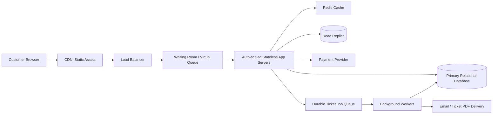

# TicketHub: Ticketing System Design

## 1. Requirements

TicketHub is an online ticketing system that lets customers discover events, view available seats, hold seats temporarily, pay for tickets, and view their purchased tickets.

### Functional requirements

- Browse and search events by keyword and city.
- View event details and the event's seat map.
- Hold one or more available seats for 10 minutes.
- Complete payment for a valid hold and create an order.
- View tickets associated with the signed-in customer.
- Release seats when a hold expires or a payment attempt is not completed successfully.

### Non-functional requirements

- **Correctness:** A seat must never be sold to more than one customer for the same event.
- **Scalability:** The service must handle normal traffic and a large sale burst of approximately 3,300 requests per second.
- **Performance:** Event pages should load in under one second under normal operating conditions.
- **Fairness:** A waiting room should control admission during a major sale and apply consistent queue rules.
- **Reliability:** Payment and ticket creation must handle retries safely, without duplicate orders or charges.

## 2. Traffic and Capacity Estimates

### Normal traffic

Assume 50,000 visitors per day, with each visitor viewing 10 pages.

- Daily page views = 50,000 × 10 = **500,000 page views per day**.
- Using the assignment's estimate, normal traffic is approximately **5 requests per second**.

This is the baseline. Actual traffic will vary during the day, and a major ticket sale creates a much higher short-lived burst.

### Major sale traffic

Assume 200,000 people arrive over 600 seconds, and each person makes 10 requests.

- Total requests = 200,000 × 10 = **2,000,000 requests**.
- Average requests during the sale window = 2,000,000 ÷ 600 ≈ **3,333 requests per second**.
- This is approximately **700 times** the normal traffic estimate of 5 requests per second.

If the event has 20,000 seats and 200,000 people try to buy tickets, approximately **180,000 people will not obtain a seat**. The system therefore needs to control admission, communicate queue status clearly, and return a clear unavailable response when seats have already been held or sold.

### Capacity approach

- Use a CDN and caching for static assets and relatively stable event details.
- Use a waiting room or virtual queue to admit a controlled number of buyers at a time; approximately 2,000 concurrent buyers is a design target, not a guarantee of capacity.
- Scale stateless application servers horizontally.
- Keep seat holds, orders, and purchases authoritative in the primary database.
- Keep database transactions short and limit each transaction to the seats involved.
- Load-test the complete system before a real major sale.

## 3. API Design

| Method and endpoint | Purpose | Expected result |
|---|---|---|
| `GET /events?search=&city=` | Search or browse events by keyword and city | `200 OK` with matching events |
| `GET /events/{id}` | Retrieve event details | `200 OK`, or `404 Not Found` |
| `GET /events/{id}/seats` | Retrieve the seat map and displayed availability | `200 OK` with seat information |
| `POST /holds` | Temporarily hold requested seats | `201 Created` with `holdId` and expiry, or `409 Conflict` |
| `POST /orders` | Complete an order for a valid hold using a payment token | `201 Created` when the order succeeds |
| `GET /me/tickets` | List tickets belonging to the authenticated customer | `200 OK` with the customer's tickets |

### Example: create a hold

Request:

```json
{
  "eventId": "event-123",
  "seatIds": ["seat-A10", "seat-A11"]
}
```

Successful response (`201 Created`):

```json
{
  "holdId": "hold-456",
  "expiresAt": "2026-10-25T15:10:00Z"
}
```

If one or more requested seats cannot be held, the server returns `409 Conflict` and does not leave a partial hold. The client should refresh the seat map and let the customer choose again.

### Example: create an order

Request:

```json
{
  "holdId": "hold-456",
  "paymentToken": "payment-token-from-provider"
}
```

The server must verify that the hold belongs to the authenticated customer and is still valid before completing the purchase. Payment processing must use an idempotency key or equivalent provider-supported mechanism so that retries do not create duplicate charges or orders.

The API should authenticate customer-specific requests, validate input, and return clear error responses. A seat map is informational: the server must re-check availability when creating the hold because another customer may have changed the seat's status after the map was loaded.

## 4. Data Model

The design uses a relational database so seat allocation and order creation can rely on transactions and constraints.

### `users`

- `id` — primary key
- `name`
- `email` — unique
- `created_at`

### `events`

- `id` — primary key
- `name`
- `venue`
- `city`
- `starts_at`
- `created_at`

### `seats`

- `id` — primary key
- `event_id` — foreign key to `events`
- `section`
- `row`
- `number`
- `status` — for example `available`, `held`, or `sold`
- `hold_id` — nullable identifier for the active hold
- `hold_expires_at` — nullable expiry timestamp

Enforce a unique constraint on `(event_id, section, row, number)` so the same physical seat is not defined twice for an event.

### `orders`

- `id` — primary key
- `user_id` — foreign key to `users`
- `hold_id`
- `payment_reference` — unique provider reference where applicable
- `idempotency_key` — unique key for safe retries
- `status` — for example `pending`, `paid`, or `failed`
- `created_at`

### `order_seats`

- `order_id` — foreign key to `orders`
- `seat_id` — foreign key to `seats`

Use a unique constraint on `order_seats.seat_id` so one seat cannot appear in multiple completed orders. The database constraints complement, but do not replace, the transaction that allocates seats.

## 5. Preventing Double-Booking

A separate availability check is not sufficient. Two customers could both read a seat as available before either request updates it. Seat allocation must be performed atomically by the database.

### Hold transaction

1. Begin a database transaction.
2. Validate the event, requested seat IDs, and authenticated customer.
3. Atomically update the requested seats only when they belong to the specified event and are either `available` or `held` with an expired hold. Set their status to `held`, assign the new hold ID, and set the expiry to 10 minutes in the future.
4. Check how many rows were updated. The number must equal the number of seats requested.
5. If fewer rows were updated than requested, roll back the entire transaction and return `409 Conflict`. No subset of the requested seats should remain held by this failed request.
6. If every requested seat was updated successfully, commit the transaction and return `201 Created` with the hold ID and expiry.

The update must use database-safe conditional logic or appropriate row locking so concurrent requests cannot both successfully claim the same seat. Keep the transaction short so requests for unrelated seats can proceed concurrently.

### Completing the purchase

1. Begin a transaction and verify that the hold belongs to the customer and has not expired.
2. Confirm that every seat in the hold is still associated with that hold.
3. Use an idempotent payment flow. Avoid charging again when the same request is retried; store and check the payment provider's reference or idempotency key.
4. When payment is confirmed, create the order and its `order_seats` records, then mark the seats as `sold` and clear their active hold data.
5. Commit the order and seat changes together. If the database transaction fails, use the payment provider's reconciliation or refund process as appropriate rather than marking an incomplete order as successful.
6. If payment fails or the hold expires, release the held seats safely, ensuring the release operation only affects seats still associated with that hold.

The transaction and conditional update prevent concurrent customers from holding the same seats. The unique database constraints provide an additional safeguard against duplicate seat assignments. A queue or cache must never be treated as the final authority for whether a seat can be purchased.

## 6. High-Level Architecture



### Component responsibilities

- **CDN:** Delivers static files such as CSS, JavaScript, images, and other cacheable assets close to users.
- **Load balancer:** Distributes requests across healthy application servers.
- **Waiting room / virtual queue:** Controls how many customers enter the sale flow at a time, applies consistent admission rules, and displays queue status. Approximately 2,000 concurrent buyers is a starting design target that must be validated through load testing.
- **Auto-scaled stateless application servers:** Handle authentication, event requests, seat holds, order workflows, and business logic. Because they are stateless, additional instances can be added as demand increases.
- **Redis cache:** Speeds up reads of event details and other relatively stable information. Cached seat availability can become stale and must not authorize a hold or purchase.
- **Primary relational database:** The source of truth for seat status, holds, orders, and completed purchases. Transactions and constraints protect booking correctness.
- **Read replica:** Handles suitable browsing and search queries to reduce read pressure on the primary database. Replication lag must be considered.
- **Payment provider:** Processes payments and supplies payment references. Payment retries must be idempotent.
- **Durable queue and background workers:** Deliver ticket emails or PDFs asynchronously so a slow delivery process does not unnecessarily block the checkout response. Jobs should be retryable and safe to process more than once.

### How the architecture handles a major sale

The CDN and cache reduce repeated work for event pages and static content. The waiting room smooths the burst by admitting a controlled number of buyers. The load balancer distributes admitted traffic across application instances, which can scale horizontally. Read replicas can serve suitable browsing queries, while seat holds and purchases go to the primary database. Short transactions and database constraints protect seat allocation. A durable queue allows ticket delivery to continue independently of the customer's checkout request.

The 2,000-concurrent-buyer target is a planning assumption, not proof that the system can sustain the required traffic. Load testing, monitoring, database capacity planning, and failure testing are required before a large sale.

## 7. Trade-offs and Alternatives

### Trade-off 1: Strict seat consistency versus throughput

**Strict consistency:** Transactions, conditional updates, and constraints protect against selling the same seat twice. Under heavy contention, requests for the same seats may wait or fail, reducing throughput.

**Higher throughput with weaker checks:** Relying on cached availability or application-level checks alone might make requests appear faster, but concurrent requests could allocate the same seat incorrectly.

**Decision:** Prioritize correctness for seat allocation. Improve throughput by keeping transactions short, updating only the requested rows, scaling stateless application servers, and serving non-critical browsing reads from cache or replicas.

### Trade-off 2: Cache speed versus freshness

**Direct database reads:** These provide more current data but can put heavy read pressure on the database during a sale.

**Caching:** Caching event details and seat-map data reduces database load and improves response time, but cached availability can become stale.

**Decision:** Cache relatively stable event information and use appropriate short lifetimes for seat-map display data. Always verify a hold or purchase against the primary database; cache contents must never determine whether a seat can be sold.

### Trade-off 3: Fair waiting room versus immediate access

**No waiting room:** Customers can enter immediately, but a sudden burst can overwhelm application servers or the database, and access may be inconsistent.

**Waiting room:** Controlled admission protects downstream services and provides a more predictable process, but customers must wait and the queue adds operational complexity.

**Decision:** Use a waiting room during high-demand sales, communicate queue status clearly, and apply consistent admission rules. Monitor the system and adjust the admission rate based on tested capacity rather than allowing uncontrolled bursts.

## Conclusion

TicketHub supports normal event browsing and prepares for major sales with a CDN, caching, a waiting room, load balancing, horizontally scalable application servers, and a relational database. The most important correctness rule is that seat holds and purchases are decided by atomic database transactions and constraints, not by cached availability alone. Idempotent payment handling and asynchronous ticket delivery make the purchase workflow more reliable under retries and heavy demand.
